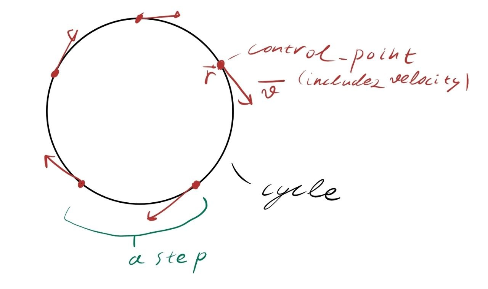
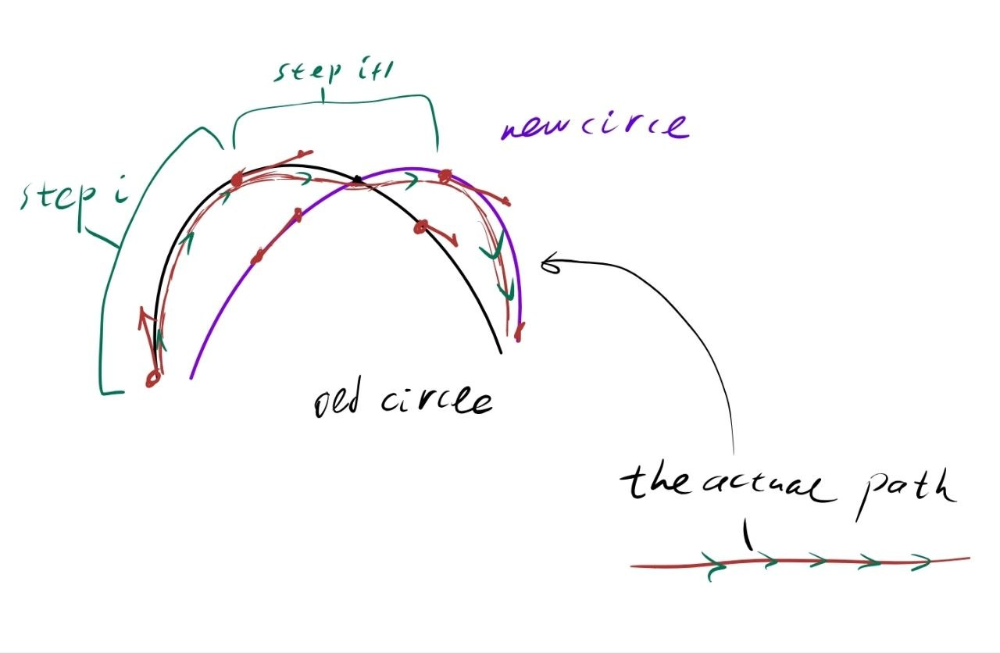
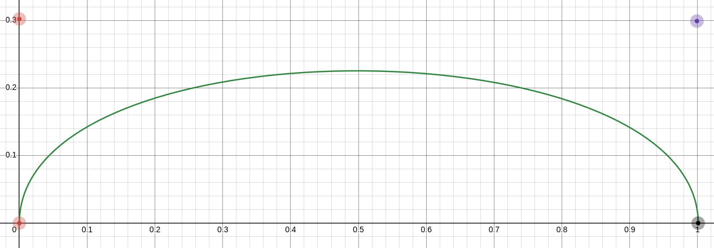

# Motion System Design

THIS PART OF TEXT IS HUMAN-GENERATED. THE AI-GENERATED PART WILL BE MARKED LATER IN TEXT.

This is minimal version of the design, now it controls one leg without interacting with drivers. 
Soon we will rewrite the code to make a proper gait with 6 legs involved in motion.

The motion for now is limited by translation of the body along xy plane.

Current shape of the step is a test, it has a lot of flaws and we will get rid of it in future.

## MAIN IDEA

So, the goal of this version of code was to create a logic to generate trajectory for an all-directional step (on a xy plane).
Out method to generate a trajectory to follow is to compute some control points and velocities on the trajectory and calculate coefficients of cubic interpolation between those points.

For example: we want to draw a circle C with our leg in a time T. We place 5 points on circle C and, knowing time T, compute velocities for them in 3D space. 



To generate smooth movement the cubic interpolation is used:

```
q(t) = a·t³ + b·t² + c·t + d
dq(t)/dt = 3a·t² + 2b·t + c
```

For faster reaction to terrain environment changes it must be computed on esp32, which leads to

THE FIRST PROBLEM:
We can't simply compute set of points for all-directional step because it involves a lot of trigonometry calculations which is slow.

BUT We can compute simple cases of step, for example is the step is toward x axis (the step is generated in zy plane, making trigonometry much easier)

So we just generate step towards X and Y axis, then superimpose control points and velocities, the result is a step in any direction we want.
The idea is succesfully stolen from NUKE (Nearly Universal Kinematics Engine) (https://vanadiumlabs.github.io/pypose/nuke-tuning.html) and improved by us.

Everyone want the movement to be smooth as baby's butt, here appears

THE SECOND PROBLEM:
While changing the directory of the step, the trajectory will not be continuous.

SOLUTION is pretty simple actually, to describe it I would need to introduce you to our movement logic (which is stolen and improved too):
Lets call a trajectory we want to follow a cycle. Divide the cycle into parts called steps (IT'S NOT THE TRAJECTORY, IT'S A PART OF IT), so each step is between adjacent control points.
The trajectory between the steps is approximated with cubic interpolation.

For example: same circle with 5 points, the parts of circle between the points are steps.



What if we want to change the plane in which circle is existing to a different one smoothly?
In our implementation we generate a separate cycle for this new circle, then we look which step of the initial cycle the end-effector moves along.
Let's call it step i. The next control point (end of the step i, which is the same point as the start of step i + 1) stays unchanged (with it's velocity). 
The following one (end of step i + 1) changes to the corresponding point on the separate cycle generated for a new circle, and the coefficients of step i + 1 in initial cycle are changed to match new points.

That's the main idea of how to make all-directional smooth movement.

## 1. Overview

THE FOLLOWING TEXT IS AI-GENERATED. IT DESCRIBES THE WHOLE SYSTEM, I WAS TOO LAZY TO GENERATE ADEQUATE DESCRIPTION MYSELF.

The system is split across two processors:

```
     PC (ROS 2)                              ESP32 (micro-ROS)
  ┌──────────────────┐                   ┌──────────────────────┐
  │                  │                   │  gait state machine  │
  │    controller    │                   │  trajectory gen      │
  │   (in future)    │  /esp/speed  ───► │  inverse kinematics  │
  │                  │  (service)        │  Jacobian / DLS      │
  └──────────────────┘                   │  polynomial eval     │
                                         │  servo PWM           │
                                         └──────────────────────┘
```

The PC sends body-frame velocity commands `(x_speed, y_speed)` via a
service call. The ESP32 handles everything downstream: gait phase,
Cartesian foot trajectory, inverse kinematics, angular velocity mapping,
and servo output. This split keeps the tight control loop local to the
hardware while letting the PC run whatever high-level logic it wants.

## 2. Frames, units, and conventions

All internal computation is in a single consistent set of units.

| Quantity                | Unit    | Where it lives                       |
|-------------------------|---------|--------------------------------------|
| Link lengths            | cm      | `leg_t.LinkLengths`                  |
| Cartesian positions     | cm      | trajectory generators, IK, Jacobian  |
| Cartesian velocities    | cm/s    | trajectory generators, Jacobian      |
| Joint angles            | radians | IK output, coefficients, servo eval  |
| Joint angular velocities| rad/s   | Jacobian output, coefficients        |
| Joint offsets / home    | radians | `leg_t.JointOffsets`, `JointHome`    |
| Servo pulse widths      | µs      | servo write, hardware boundary       |

**Radians everywhere in the pipeline.** Degrees appear only inside the
servo write function, where `RAD2DEG` is applied immediately before
`writeMicroseconds`. No other layer knows about degrees.

**Frame:** X forward, Y left, Z up. The hip is the origin. Positive X
moves the foot forward, positive Y moves the foot left, positive Z lifts
the foot.

## 3. Layer 1 — Kinematics

### 3.1 Forward kinematics

Maps joint angles `q = [q0, q1, q2]` (radians) to Cartesian foot position
in the hip frame:

```
phi1 = q0 + J1_off
phi2 = q1 + J2_off
phi3 = q2 + J3_off

R   = L1 + L2·sin(phi2) + L3·sin(phi3 − phi2)

x   = −R · cos(phi1)
y   =  R · sin(phi1)
z   =  L2·cos(phi2) − L3·cos(phi3 − phi2)
```

### 3.2 Inverse kinematics

Given a target `(x, y, z)`, solve for `q`. Uses the standard
two-link-in-a-plane construction:

```
r_xy   = sqrt(x² + y²) − L1
L23²   = r_xy² + z²
L23    = sqrt(L23²)

cos(θ) = (L2² + L23² − L3²) / (2·L2·L23)      (interior knee angle)
cos(Σ) = (L2² + L3² − L23²) / (2·L2·L3)       (interior hip angle)

q0 = atan2(y, −x)               − J1_off
q1 = atan2(r_xy, z) − θ         − J2_off
q2 = Σ                          − J3_off
```

Edge cases:
- `r_xy < 0`        → target inside the L1 cylinder, unreachable
- `L23 < eps`       → target on the L1 axis, degenerate
- `cos(·) > 1` or `< -1` → law of cosines has no real solution

In all three cases the function returns a non-OK status and leaves the
point unchanged for the caller to handle.

### 3.3 Jacobian

3×3 matrix `J(q)` mapping joint angular velocity to Cartesian foot
velocity: `v = J · q̇`.

### 3.4 Damped least squares

Given a desired Cartesian velocity `v` and a joint configuration `q`,
solve `J(q) · q̇ = v` for `q̇`. A naive inversion breaks near
singularities; the standard fix is **damped least squares**:

```
q̇ = Jᵀ (J Jᵀ + λ² I)⁻¹ v
```

with the damping factor chosen adaptively:

```
λ² = k · ‖J‖²_F,    k ≈ 1e-2
```

## 4. Layer 2 — Cartesian trajectory generation

The foot traces a repeating loop in the body frame. The loop has two
phases:

**Swing** — foot in the air, moving forward. The trajectory is a cubic Bezier arc with following control points:

- `P0 = (0, 0, 0)` 
- `P1 = (0, 0, h)` 
- `P2 = (L, 0, h)` 
- `P3 = (L, 0, 0)` 

where `L = swing_time · x_speed` and `h = 0.3·|L|`. The parameter is
eased with a smoothstep `e(t) = 3t² − 2t³` so velocity starts and ends
at zero — the foot lifts off and lands gently.

it provides us beautiful shape:



**Stance** — foot on the ground, moving backward at body speed. A
straight line in the body frame from the touchdown point back to the
start of the next stride.

The two phases are generated independently, then concatenated into a
single cycle buffer with `n_points = n_swing + n_stance + 1`.

### 4.1 Per-axis generation and superposition

X and Y trajectories are generated independently as separate Cartesian
paths, then summed:

```
pos_combined = pos_x + pos_y
vel_combined = vel_x + vel_y
```

For Z, the two axes each contribute a lift; taking the sum double-counts
the swing height on diagonal motion. The current implementation uses the
**larger** of the two contributions:

```
pos_z = max(pos_x.z, pos_y.z)
vel_z = (corresponding axis's vel.z)
```

## 5. Layer 3 — Cycles and steps

A **step** covers one `StepTime`-long segment of a trajectory. A
**cycle** is a fixed-length sequence of steps that closes on itself
(foot ends where it began).

`step_t` stores:

- `start`, `end` — joint angle and angular velocity at the two endpoints
- `coefficients[3][4]` — cubic Hermite polynomial per joint
- `StepTime` — duration of the segment, seconds

The polynomial for joint `j` is:

```
q_j(t) = a·t³ + b·t² + c·t + d,     t ∈ [0, StepTime]
```

Coefficients come from the standard cubic Hermite construction matching
the endpoint positions and velocities:

```
h = StepTime,   Δq = q_end − q_start

a = (q̇_start + q̇_end) / h² − 2·Δq / h³
b = 3·Δq / h² − (2·q̇_start + q̇_end) / h
c = q̇_start
d = q_start
```

Because each step is stored in *local* time (starting at 0), there is no
per-step time offset to track; the evaluation is a single Horner pass:

```
q(t) = ((a·t + b)·t + c)·t + d
```

## 6. Layer 4 — Gait state machine

Two cycles coexist at all times:

**Inertial cycle** — the reference. Regenerated whenever a new speed
command arrives. Anchored at a fixed neutral foot pose (deliberately not
at the current pose, to avoid pulling the leg outside its workspace when
commands change).

**Main cycle** — what the servos actually follow. Maintained incrementally
via a receding-horizon scheme.

### 6.1 The receding-horizon update

Let `i` be the currently executing step. On each step transition:

```
main.step[i+1].start = main.step[i].end              (continuity)
main.step[i+1].end   = inertial.step[i+1].end        (absolute reference)
recompute coefficients for step i+1
```

Then advance `i ← (i+1) mod N`.

Two key properties:

- **One-step lookahead**: the trajectory being executed was planned with
  the command that was current one step ago. At 200 ms step time, this
  introduces 200 ms of latency from command to full effect. Imperceptible
  for walking.

- **Absolute endpoint**: the target for step `i+1` is the inertial
  cycle's absolute position, not a relative displacement. This is a
  deliberate choice. Relative displacement accumulates errors — servo
  lag, foot slip, external disturbance — and the leg drifts. Absolute
  targets pull the leg back toward the reference every step. The tradeoff
  is that if the leg is far from the reference, the step is large. Since
  the reference is regenerated from a fixed neutral pose on every command
  change, the "far from reference" case doesn't arise in normal operation.

### 6.2 Stopping

Zero speed produces a constant inertial cycle: all endpoints equal to
the neutral pose, all velocities zero. The Hermite polynomials collapse
to constants, and the leg holds position.

## 7. Runtime and timers

Two RCL timers drive the system, both running in the micro-ROS executor
at 20 ms period (50 Hz).

**Motion timer** — `gait_motion_tick()`:

1. If `cmd_dirty`, regenerate the inertial cycle.
2. Check elapsed time since the current step started.
3. If `elapsed ≥ StepTime`, advance to the next step.

**Servo timer** — `gait_servo_tick()`:

1. Read the current step and elapsed time.
2. Evaluate all three joint polynomials at that time.
3. Write the resulting angles to the servos.

Both timers run at the same rate, but the split keeps the two concerns
separated: the motion timer is event-driven and occasionally expensive;
the servo timer is periodic and cheap.

At 20 ms with 200 ms steps, the servo timer produces 10 samples per step.
This is smooth enough for hobby servos, whose internal deadband and
mechanical time constant are much larger than 20 ms.

## 8. Command interface

Speed commands arrive on a ROS 2 service:

```
# spider_interfaces/srv/SpiderSpeed
float32[2] data      # [x_speed, y_speed] in cm/s
---
int16 err            # 0 = OK, negative = error
```

The callback sets `cmd_x_speed`, `cmd_y_speed`, and raises `cmd_dirty`.
The motion timer picks this up on its next tick and regenerates the
inertial cycle. Because the update is deferred, the service call returns
immediately and doesn't block the executor.

## 9. Current state and roadmap

### Implemented

- Kinematics: FK, IK, analytic Jacobian, DLS solve
- Trajectory: cubic Bézier swing, linear stance, XY Cartesian superposition
- Cycle: cubic Hermite coefficient generation, local-time polynomial form
- Gait: two-cycle receding-horizon state machine, 50/50 duty
- Runtime: two-timer architecture, stop/hold behavior
- Interface: `SpiderSpeed` service, debug topic, servo override topic

### Not yet implemented

- **Multi-leg coordination.** Phase offsets between legs (tripod, ripple,
  wave gaits) are not implemented. The current code drives one leg.
- **Body transforms.** Turning, body pitch/roll, IMU stabilization. All
  of these compose with the per-leg Cartesian target before IK, in a
  layer between gait and kinematics.
- **Alternative trajectory shapes.** The Bézier is the only swing shape;
  Chebyshev or cycloid profiles may produce smoother motion at higher
  speeds. The shape interface isn't yet abstracted.

## 10. Files

```
esp_spider3/
├── esp_spider3.ino       micro-ROS plumbing, state machine, callbacks
├── structs.h / .cpp      leg_t, point_t, step_t, cycle_t; init/coeff math
├── kinematics.h / .cpp   FK, IK, Jacobian, DLS
├── trajectory.h / .cpp   per-axis generators, superposition, step_cycle
├── gait.h / .cpp         main + inertial cycle state machine
└── esp_node.h / .cpp     servo-angle conversion, unit helpers
```

Each module is intended to be usable in isolation. `kinematics` has no
knowledge of trajectories, `trajectory` has no knowledge of the gait
state machine, and `gait` has no knowledge of servo hardware. The only
shared types are `point_t`, `step_t`, and `cycle_t` in `structs.h`.
